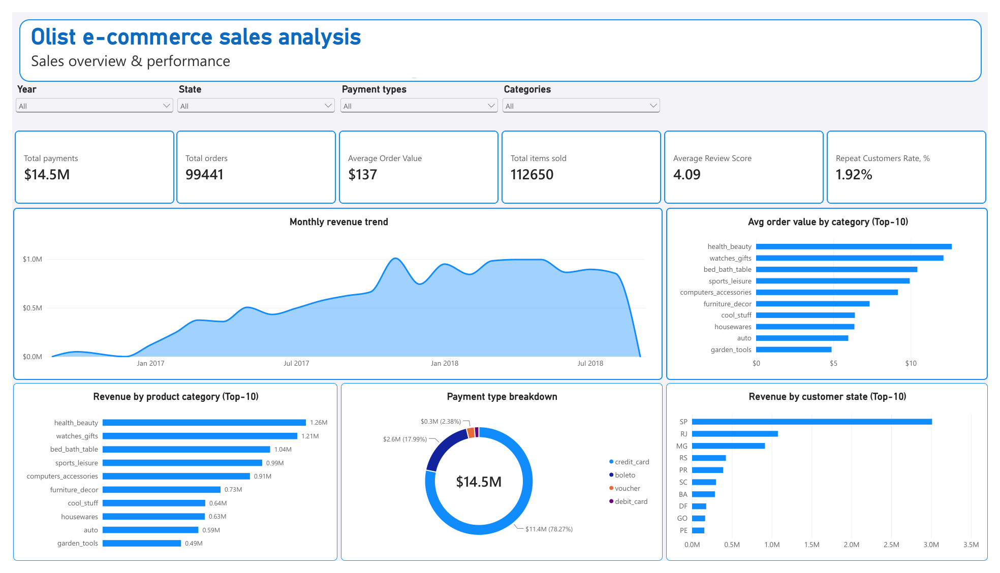
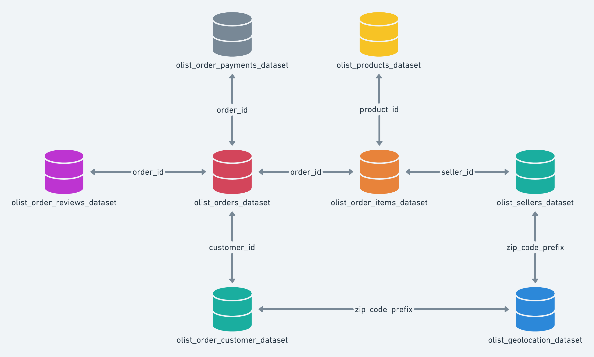
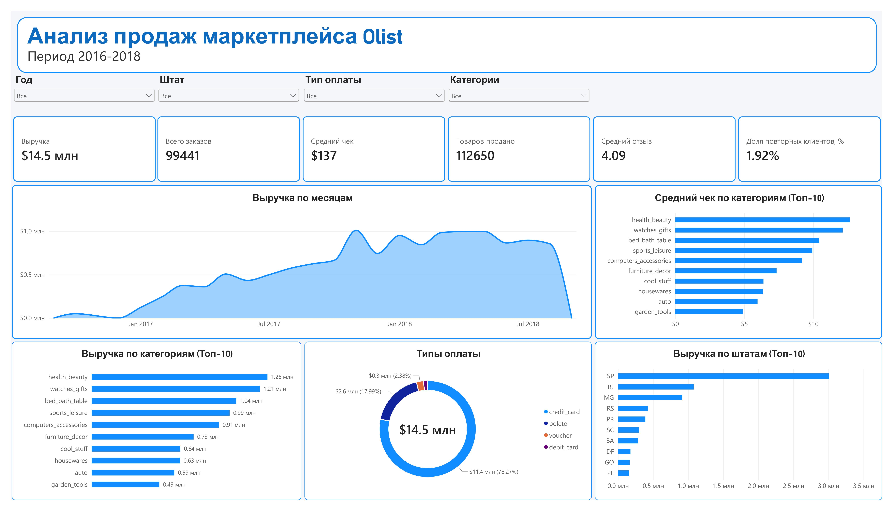

# 📊 Olist E-commerce Analytics | Анализ продаж маркетплейса Olist

[en English](#english) | [🇷🇺 Русский](#русский)

> End-to-end e-commerce analytics project based on the Brazilian Olist marketplace dataset.

<a id="english"></a>

This project demonstrates an end-to-end data analytics workflow — from database design and SQL analysis to exploratory data analysis in Python and interactive dashboards in Power BI.

The project focuses on **sales, customers, products, delivery performance, sellers and customer reviews**.

---

## 🎯 Project Goals

The main objective is to analyze the Olist e-commerce dataset and identify patterns that can support business decision-making.

The project answers questions such as:

* 📈 How do sales and order volumes change over time?
* 🛍️ Which product categories generate the most revenue?
* 👥 How many customers make repeat purchases?
* 🌎 Which states generate the most orders?
* ⭐ How does delivery performance affect customer satisfaction?
* 🏪 Which sellers demonstrate the best and worst performance?
* 💰 What factors are associated with higher order value?

---

## 🧰 Tech Stack

| Technology                  | Purpose                              |
| --------------------------- | ------------------------------------ |
| 🐍 **Python**               | Data preparation, EDA and analysis   |
| 🐼 **Pandas**               | Data manipulation and transformation |
| 🔢 **NumPy**                | Numerical calculations               |
| 📊 **Matplotlib / Seaborn** | Data visualization                   |
| 🔎 **SQL**                  | Data analysis and business queries   |
| 📈 **Power BI**             | Interactive dashboards               |
| 📐 **DAX**                  | Analytical measures                  |
| 🔧 **Git / GitHub**         | Version control                      |

---

## 🗂️ Project Structure

```text
olist-ecommerce-analytics/
│
├── data/
│   ├── README.md
│   ├── olist_customers_dataset.csv
│   ├── olist_geolocation_dataset.csv
│   ├── olist_order_items_dataset.csv
│   ├── olist_order_payments_dataset.csv
│   ├── olist_order_reviews_dataset.csv
│   ├── olist_orders_dataset.csv
│   ├── olist_products_dataset.csv
│   ├── olist_sellers_dataset.csv
│   └── product_category_name_translation.csv
│
├── database/
│   ├── images/
│   │   └── db_schema.png
│   └── schema/
│       ├── 01_tables_creation.sql
│       ├── 02_constraints.sql
│       └── 03_indexes.sql
│
├── dashboards/
│   ├── sales_overview.pbix
│   ├── sales_overview_dashboard_en.png
│   └── sales_overview_dashboard_ru.png
│
├── notebooks/
│   ├── 01_data_preparation.ipynb
│   └── 02_eda.ipynb
│   
├── sql/
│   ├── 01_data_quality.sql
│   ├── 02_sales_analysis.sql
│   ├── 03_customer_analysis.sql
│   ├── 04_product_analysis.sql
│   ├── 05_delivery_analysis.sql
│   └── 06_reviews_analysis.sql
│
├── .gitignore
├── README.md
└── requirements.txt
```

---

## 🗄️ Database

The project uses **PostgreSQL** as the analytical database.

The database schema was designed to represent the main entities of the Olist marketplace:

* 👤 Customers
* 🛒 Orders
* 📦 Order items
* 💳 Payments
* ⭐ Reviews
* 🏷️ Products
* 🏪 Sellers
* 🌎 Geolocation

### Database Schema



The database setup scripts include:

* table creation;
* primary and foreign keys;
* constraints;
* indexes for frequently used columns.

---

## 🔎 SQL Analysis

The SQL section contains analytical queries grouped by business domain.


### 💰 Sales Analysis

`01_sales_analysis.sql`

* total revenue;
* monthly sales dynamics;
* order volume;
* average order value;
* top categories and products.

### 👥 Customer Analysis

`02_customer_analysis.sql`

* customers by state;
* orders per customer;
* customer spending;
* repeat customers;
* customer segmentation.

### 🏷️ Product Analysis

`03_product_analysis.sql`

* category performance;
* product rankings;
* revenue contribution;
* cumulative revenue share;
* ABC analysis.

### 🚚 Delivery Analysis

`04_delivery_analysis.sql`

* delivery time;
* delivery delays;
* late delivery rate;
* regional delivery performance.

### ⭐ Reviews Analysis

`05_reviews_analysis.sql`

* review score distribution;
* average review score;
* relationship between delivery delays and customer satisfaction.

SQL techniques used in the project include:

`JOIN` · `GROUP BY` · `CASE WHEN` · `CTE` · `DATE_TRUNC` · `LAG` · `ROW_NUMBER` · `RANK` · Window Functions · Subqueries

---

## 🐍 Python Analysis

The Python analysis is divided into two notebooks.

### 1️⃣ Data Preparation

`01_data_preparation.ipynb`

* loading raw datasets;
* data type conversion;
* missing value analysis;
* duplicate detection;
* data validation;
* feature creation;
* preparation of analytical datasets.

### 2️⃣ Exploratory Data Analysis

`02_eda.ipynb`

Exploration of:

* 📈 sales dynamics;
* 🛍️ product categories;
* 👥 customers;
* 🌎 geography;
* 🚚 delivery performance;
* ⭐ customer reviews.

---

## 📊 Power BI Dashboard

The Power BI dashboard provides an interactive overview of the Olist marketplace.

### Dashboard Preview


---


<a id="Русский"></a>

Этот проект демонстрирует полный цикл аналитики данных: от проектирования базы данных и анализа с помощью SQL до разведочного анализа данных (EDA) на Python и создания интерактивных дашбордов в Power BI.

В центре внимания проекта — **продажи, клиенты, товары, показатели доставки, продавцы и отзывы покупателей**.

---

## 🎯 Цели проекта

Основная задача — проанализировать набор данных платформы электронной коммерции Olist и выявить закономерности, которые помогут в принятии бизнес-решений.

Проект дает ответы на следующие вопросы:

* 📈 Как меняются объемы продаж и количество заказов с течением времени?
* 🛍️ Какие категории товаров приносят наибольшую выручку?
* 👥 Какая доля клиентов совершает повторные покупки?
* 🌎 В каких штатах оформляется больше всего заказов?
* ⭐ Как качество доставки влияет на удовлетворенность клиентов?
* 🏪 Какие продавцы демонстрируют лучшие и худшие результаты?
* 💰 Какие факторы связаны с более высокой стоимостью заказа?

## 🧰 Технический стек

| Инструмент                       | Для чего используется            |
| --------------------------- | ------------------------------------ |
| 🐍 **Python**               | Подготовка, разведочный анализ |
| 🐼 **Pandas**               | Трансформация данных                 |
| 🔢 **NumPy**                | Математические вычисления            |
| 📊 **Matplotlib / Seaborn** | Визуализация данных                 |
| 🔎 **SQL**                  | Запросы к базе данных                |
| 📈 **Power BI**             | Дашборды                             |
| 📐 **DAX**                  | Аналитические меры                   |
| 🔧 **Git / GitHub**         | Контроль версий                      |

---

## 🗂️ Структура проекта

```text
olist-ecommerce-analytics/
│
├── data/
│   ├── README.md
│   ├── olist_customers_dataset.csv
│   ├── olist_geolocation_dataset.csv
│   ├── olist_order_items_dataset.csv
│   ├── olist_order_payments_dataset.csv
│   ├── olist_order_reviews_dataset.csv
│   ├── olist_orders_dataset.csv
│   ├── olist_products_dataset.csv
│   ├── olist_sellers_dataset.csv
│   └── product_category_name_translation.csv
│
├── database/
│   ├── images/
│   │   └── db_schema.png
│   └── schema/
│       ├── 01_tables_creation.sql
│       ├── 02_constraints.sql
│       └── 03_indexes.sql
│
├── dashboards/
│   ├── sales_overview.pbix
│   ├── sales_overview_dashboard_en.png
│   └── sales_overview_dashboard_ru.png
│
├── notebooks/
│   ├── 01_data_preparation.ipynb
│   └── 02_eda.ipynb
│   
├── sql/
│   ├── 01_data_quality.sql
│   ├── 02_sales_analysis.sql
│   ├── 03_customer_analysis.sql
│   ├── 04_product_analysis.sql
│   ├── 05_delivery_analysis.sql
│   └── 06_reviews_analysis.sql
│
├── .gitignore
├── README.md
└── requirements.txt
```
---
## 🗄️ База данных

В проекте используется **PostgreSQL**.

Состав базы данных:

* 👤 Customers
* 🛒 Orders
* 📦 Order items
* 💳 Payments
* ⭐ Reviews
* 🏷️ Products
* 🏪 Sellers
* 🌎 Geolocation

### Схема базы данных



Скрипты настройки базы данных:

* Создание базы данных;
* Первичные и внешние ключи;
* Констрейнты;
* Индексы

---

## 🔎 SQL анализ

Раздел SQL содержит аналитические запросы, сгруппированные по бизнес-областям


### 💰 Анализ продаж 

`01_sales_analysis.sql`

* общая выручка;
* динамика продаж по месяцам;
* объемы продаж;
* средний чек;
* топ категорий и товаров.

### 👥 Анализ клиентов

`02_customer_analysis.sql`

* распределение клиентов по штатам;
* oколичество заказов на клиента;
* расходы клиентов;
* повторные клиенты;
* сегментация клиентов.

### 🏷️ Анализ товаров

`03_product_analysis.sql`

* продажи по категории;
* ранжирование товаров по чеку и обьемам;
* доля выручки по категориям.

### 🚚 Анализ доставки

`04_delivery_analysis.sql`

* время достави;
* задержки;
* коэфициент задержек;

### ⭐ Анализ отзывов

`05_reviews_analysis.sql`

* распределение отзывов;
* средняя оценка;
* взаимосвязь между доставкой и оценкой в отзыве.

Используемые функции SQL:

`JOIN` · `GROUP BY` · `CASE WHEN` · `CTE` · `DATE_TRUNC` · `LAG` · `ROW_NUMBER` · `RANK` · Оконные функции · Подзапросы

---

## 🐍 Анализ в Python 

Анализ состоит из двух ноутбуков.

### 1️⃣ Подготовка данных

`01_data_preparation.ipynb`

* загрузка csv-файлов;
* преобразование типов данных;
* обработка пропусков;
* проверка дубликатов;
* валидация данных;
* создание новых признаков;

### 2️⃣ Исследовательский анализ

`02_eda.ipynb`

Исследование:

* 📈 динамики продаж;
* 🛍️ категорий товаров;
* 👥 клиентов;
* 🌎 географии продаж;
* 🚚 доставки;
* ⭐ отзывов.

## 📊 Power BI дашборд

### Превью дашборда

